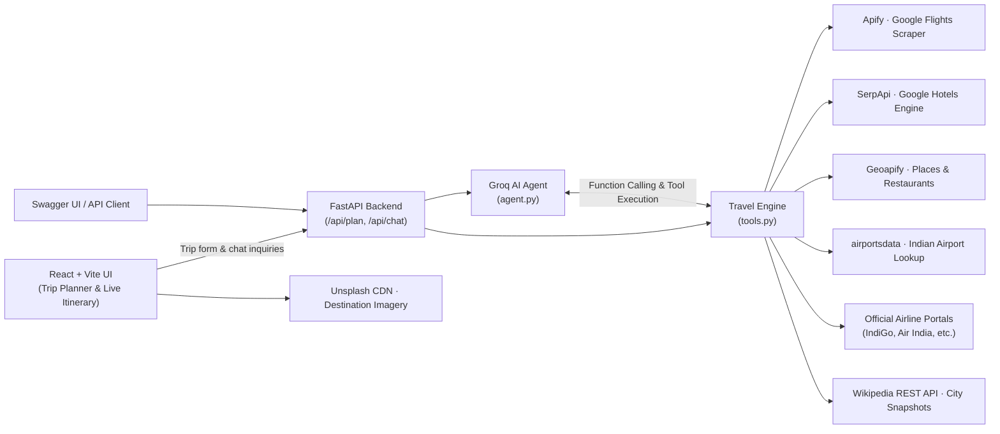

# Dream Travel Agency · AI Travel Planner

**Dream Travel Agency** is an intelligent full-stack AI travel planner crafted specifically for domestic travel across India. The application combines a modern **React (Vite + Tailwind CSS)** frontend with a high-performance **FastAPI** Python backend powered by **Groq** function-calling AI agents, live flight scraping, Google Hotels through SerpApi, Geoapify places, and official airline booking portals.

Travellers can plan one-way or round-trip journeys, review real-time ranked flight fares with direct airline booking buttons (IndiGo, Air India, SpiceJet, Akasa Air, Vistara), inspect curated hotels and restaurants, explore top iconic sights with direct Google Maps navigation, and chat interactively with the AI travel assistant.

---

## Architecture

The React app in `frontend/` provides a responsive split-screen layout with dual view navigation (**Trip Planner** & **Live Itinerary**). It communicates directly with the FastAPI backend in `backend/`.



### Core Components
- `backend/app.py`: FastAPI server exposing `/api/plan`, `/api/chat`, `/api/cities`, `/api/flights`, `/api/hotels`, `/api/restaurants`, `/api/attractions`, and `/api/health`.
- `backend/agent.py`: Groq conversational travel agent coordinating tool calling, reasoning, and context formatting.
- `backend/tools.py`: Unified travel search engine handling airport resolution, round-trip flight scraping (Apify/SerpApi), hotel queries, dining recommendations, and top 7 Indian attractions.
- `backend/prompt.py`: Detailed system prompts enforcing domestic Indian travel constraints and verified facts.
- `frontend/src/App.jsx`: Main React application managing trip parameters, dual-tab view states, theme switching, and live deck synchronization.
- `frontend/src/components/`: Modular UI components:
  - `Sidebar.jsx`: Navigation and high-contrast light/dark theme toggle.
  - `TripForm.jsx`: Origin, destination, dates, round-trip selector, and budget form.
  - `ChatPanel.jsx`: Scrollable assistant conversation with instant jump button to Itinerary.
  - `HeroBanner.jsx`: High-resolution destination landmark hero with auto-fallback.
  - `CapsuleNav.jsx`: Swipeable category pills (Flights, Hotels, Restaurants, Places to Visit).
  - `FlightDeck.jsx`: Outbound and return flight cards with direct airline booking links.
  - `HotelDeck.jsx`: Curated accommodations with nightly rates and map links.
  - `RestaurantDeck.jsx`: Authentic regional dining spots with Google Maps integration.
  - `AttractionDeck.jsx`: Top 7 iconic sights with maps and "Ask about this place" AI prompt.
  - `DetailModal.jsx`: Interactive modal for in-depth viewing and follow-up prompts.

---

## Agent Workflow

1. **Trip Formulation:** The user selects origin and destination cities (with multi-airport support for major metros like Goa `GOI`/`GOX`, Delhi `DEL`/`HDO`, Mumbai `BOM`/`NMI`, Hyderabad `HYD`, Bengaluru `BLR`), dates, and optional budget.
2. **Concurrent Search & Scraping:** When submitted to `/api/plan`:
   - **Flights:** Resolves IATA codes and queries live domestic schedules. For round trips, outbound and return searches run with separate fares and direct booking deep-links.
   - **Hotels:** Queries Google Hotels via SerpApi (or OpenStreetMap fallback) based on user preference (City Center vs. Airport Transit).
   - **Attractions & Dining:** Fetches top 7 iconic tourist landmarks and authenticated local restaurants via Geoapify and curated Indian city knowledge.
3. **Synthesis & Itinerary Drafting:** Groq agent drafts an itinerary and summarizes the must-visit highlights.
4. **Auto-Switching View:** The mobile and tablet view automatically switches to the **Live Itinerary** tab upon receiving results so travellers immediately see available flights and options.
5. **Interactive Follow-ups:** Travellers can ask contextual questions ("What are the best timings for Golconda Fort?", "Suggest a cheaper hotel") via the chat bar, or tap "Ask about this place" on any attraction card to get immediate tips.

---

## Integrations & APIs

- **Groq API (`openai/gpt-oss-120b`):** Fast inference for the conversational AI agent and tool calling. [Groq Console](https://console.groq.com)
- **Apify (`APIFY_TOKEN`):** Live Indian domestic flight schedules and indicative fares via the Google Flights Scraper actor.
- **SerpApi (`SERPAPI_KEY`):** Google Hotels search engine for verified accommodations, star ratings, and prices. [SerpApi Documentation](https://serpapi.com/google-hotels-api)
- **Geoapify (`GEOAPIFY_KEY`):** Geocoding and Places API for regional dining and tourist points of interest. [Geoapify Documentation](https://www.geoapify.com/)
- **Direct Airline Portals:** Bypasses OTA intermediaries and redirects booking clicks directly to official airline engines (IndiGo `goindigo.in`, Air India `airindia.com`, SpiceJet, Akasa Air, Vistara).
- **Wikipedia REST API & Unsplash:** Dynamic city overviews and high-resolution landmark photography.
- **Airportsdata:** Comprehensive database of Indian domestic and international airports and IATA codes.

---

## Local Setup

### 1. Prerequisites
- Python 3.10+ (Python 3.11 or 3.12 recommended)
- Node.js 18+ and npm

### 2. Backend Setup

Open a terminal at the repository root:

```powershell
# Navigate to backend directory
Set-Location backend

# Create and activate virtual environment (optional but recommended)
python -m venv venv
.\venv\Scripts\Activate.ps1

# Install dependencies
pip install -r requirements.txt

# Create environment file from template
Copy-Item .env.example .env
```

Edit `backend/.env` with your API credentials:
```env
GROQ_API_KEY=your_groq_api_key_here
GROQ_MODEL_ID=openai/gpt-oss-120b
APIFY_TOKEN=your_apify_token_optional
SERPAPI_KEY=your_serpapi_key_optional
GEOAPIFY_KEY=your_geoapify_key_optional
```

Start the FastAPI development server:
```powershell
python -m uvicorn app:app --host 127.0.0.1 --port 8000 --reload
```
Open [http://127.0.0.1:8000/docs](http://127.0.0.1:8000/docs) in your browser to access the interactive Swagger API documentation.

### 3. Frontend Setup

Open a second terminal at the repository root:

```powershell
# Navigate to frontend directory
Set-Location frontend

# Install npm dependencies
npm install

# Start Vite dev server
npm run dev
```

Open [http://127.0.0.1:5173](http://127.0.0.1:5173) in your browser. The Vite development server automatically proxies `/api` calls to `http://127.0.0.1:8000`.

---

## API Endpoints

| Method | Endpoint | Description |
|---|---|---|
| `GET` | `/api/health` | Health check verifying API server status. |
| `GET` | `/api/cities` | Returns list of supported Indian domestic destinations with airport codes. |
| `POST` | `/api/plan` | Primary planning endpoint: queries flights, hotels, restaurants, and attractions. |
| `POST` | `/api/chat` | Conversational endpoint for follow-up questions and travel advice. |
| `POST` | `/api/flights` | Direct search for outbound and return flight schedules. |
| `POST` | `/api/hotels` | Direct search for hotels and stays with nightly pricing. |
| `POST` | `/api/restaurants` | Direct search for nearby authentic restaurants and dining spots. |
| `POST` | `/api/attractions` | Direct search for top 7 iconic tourist attractions with map coordinates. |

---

## Deployment (Render)

Both the FastAPI backend and React frontend can be hosted seamlessly on [Render](https://render.com).

### Backend (Web Service)
1. In the Render Dashboard, open your existing backend **Web Service** (or create a new Web Service pointing to your GitHub repository).
2. Configure settings:
   - **Environment:** Python
   - **Root Directory:** `backend` (or leave blank if repository root is used)
   - **Build Command:** `pip install -r requirements.txt`
   - **Start Command:** `uvicorn app:app --host 0.0.0.0 --port $PORT`
3. In the **Environment Variables** tab, add:
   - `GROQ_API_KEY`: Your Groq API key
   - `GROQ_MODEL_ID`: `openai/gpt-oss-120b`
   - `APIFY_TOKEN`: Your Apify token (optional)
   - `SERPAPI_KEY`: Your SerpApi key (optional)
   - `GEOAPIFY_KEY`: Your Geoapify key (optional)
4. Set the **Branch** to `main` (Render deploys automatically on every push to `main`).

### Frontend (Static Site or Web Service)
1. Open your frontend service on Render.
2. Configure settings:
   - **Root Directory:** `frontend`
   - **Build Command:** `npm ci && npm run build`
   - **Publish Directory:** `dist`
3. In **Environment Variables**, set:
   - `VITE_API_BASE_URL`: Your deployed backend Render URL (e.g., `https://your-backend.onrender.com`).
4. Set the **Branch** to `main`.

---

## Testing & Quality Assurance

- **Vite Build Verification:** Run `npm run build` in `frontend/` to ensure bundle compilation succeeds with zero warnings.
- **Python Code Audit:** Run `python -m py_compile backend/*.py` to ensure all Python backend modules are syntactically sound.
- **Responsive Testing:** Built-in CSS media queries specifically target mobile viewports (< 640px), tablet screens (641px - 1023px), and desktop displays (>= 1024px).

---

## Known Constraints & Domestic Focus

- **Domestic India Only:** The planner is strictly dedicated to Indian domestic routes and travel hubs.
- **Airline Portals:** Flight booking buttons link directly to verified official carrier portals (IndiGo, Air India, SpiceJet, etc.). Ticket availability and real-time fares must be confirmed with the respective airline before purchase.
- **Place Details:** Restaurant hours and entry tickets should be verified with the venue prior to visiting.
